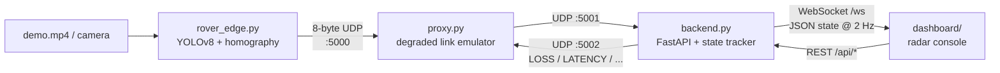

# C.R.A.T.E.R.

**Constrained Reconnaissance & Telemetry** — a simulated lunar-rover mission-control pipeline built for bandwidth-starved, unreliable links.

A rover detects rocks with an edge-deployed YOLOv8 model, compresses every detection into an **8-byte UDP packet**, and sends it across an emulated lossy lunar link. Mission control rebuilds a live hazard map from whatever survives, ages out stale detections, and shows the result on a real-time radar console, where you can degrade the link on the fly and watch the map cope.

> Team: **Arcane** · Event: **ATEC** <!-- TODO: fill in team members / competition name / link -->

<!-- TODO: add a dashboard screenshot or GIF here, e.g.  -->

---

## Why

Deep-space links are narrow, laggy and lossy. Streaming video or verbose JSON is not an option, so the rover has to do its perception **on board** and send only the result. C.R.A.T.E.R. explores that trade-off end to end:

- **Edge perception**: a YOLOv8n model trained on synthetic lunar terrain, exported to ONNX.
- **Tiny wire format**: one detection = 8 bytes, versus roughly 90 bytes for the same data as JSON.
- **Hostile network emulation**: uniform loss, burst loss (Gilbert-Elliott), latency, jitter, reordering, bit corruption and total blackouts, all adjustable live.
- **Graceful degradation on the ground**: hazards are tracked, associated across repeated sightings, and shown with decaying confidence and a growing uncertainty radius when the link goes quiet.

## Architecture



| Component | File | Role |
|---|---|---|
| Rover edge node | `rover_edge.py` | Runs YOLOv8 on each frame, projects each box's bottom-centre pixel onto the ground plane with a homography, packs and sends telemetry |
| Network emulator | `proxy.py` | UDP relay `5000 → 5001` with a heap-based delivery queue; applies loss, burst loss, latency, jitter, corruption; control port `5002` |
| Mission control | `backend.py` | Receives UDP, tracks hazards, simulates rover motion, serves the dashboard, streams state over WebSocket, exposes REST controls |
| Dashboard | `dashboard/` | Canvas radar map, hazard inspector, live charts, link-degradation controls |
| Data contract | `telemetry.py` | 8-byte pack/unpack |
| Config | `config.py` | Ports, degradation defaults, thresholds, logging |
| Launcher | `main.py` | Starts backend, proxy and rover node, and shuts them down together |

## Telemetry protocol

One detection is a fixed 8-byte big-endian struct (`!BhhBH`):

| Bytes | Field | Encoding |
|---|---|---|
| 1 | Header | high nibble = `rover_id` (0–15), low nibble = class (0–13 hazards, 15 = heartbeat) |
| 2 | `x` | signed 16-bit, decimetres (0.1 m resolution) |
| 2 | `y` | signed 16-bit, decimetres |
| 1 | Confidence | 0–100 % |
| 2 | Sequence number | unsigned 16-bit, wraps at 65535 |

Coordinates are relative to the rover and are clamped to the int16 range. The backend rotates them by the rover's heading and offsets them by its position to get global map coordinates.

## Link emulator

`proxy.py` sits between rover and ground and can be reconfigured at runtime.

| Effect | Behaviour | Default |
|---|---|---|
| Uniform loss | Each packet dropped with probability *p* | 20 % |
| Burst loss | Gilbert-Elliott two-state chain: GOOD (2 % loss, 5 % chance to enter BAD) ↔ BAD (90 % loss, 30 % chance to recover) | off |
| Latency + jitter | Delivery time = latency ± uniform jitter, via a min-heap queue (so packets can reorder) | 50 ms ± 10 ms |
| Corruption | Flips one random bit in a packet | 0 % |
| Blackout | Sets loss to 100 % for *N* seconds, then restores the previous value | — |

The queue holds at most 1000 packets; overflow is counted as a drop.

**Control port:** send UDP text commands to `127.0.0.1:5002`:

```bash
echo -n "LOSS:0.4"     | nc -u -w1 127.0.0.1 5002   # 40 % loss
echo -n "LATENCY:0.2"  | nc -u -w1 127.0.0.1 5002   # seconds
echo -n "JITTER:0.05"  | nc -u -w1 127.0.0.1 5002   # seconds
echo -n "CORRUPT:0.1"  | nc -u -w1 127.0.0.1 5002
echo -n "BURST:1"      | nc -u -w1 127.0.0.1 5002   # enable Gilbert-Elliott
```

## Hazard tracking

For each packet the backend converts the detection to map coordinates, snaps it to a 1.5 m grid, and associates it with an existing hazard of the same class within 2.5 m (otherwise it creates `H-<n>`). Matched hazards get smoothed positions (80/20) and the highest confidence seen. Each hazard then ages:

| State | Age | Displayed confidence | Position uncertainty |
|---|---|---|---|
| `FRESH` | < 6 s | as received | 0.45 m |
| `AGING` | 6–20 s | exponential decay | grows up to 3 m |
| `STALE` | ≥ 20 s | 40 % of original (floor 5 %) | 2.5–4.5 m |

Hazards are purged after 120 s without a new sighting.

## Quick start

**Requirements:** Python 3.10+, and an internet connection on first load (the dashboard pulls Chart.js from a CDN).

```bash
git clone https://github.com/heaven-04/Arcane_ATEC.git
cd Arcane_ATEC
python -m venv .venv && source .venv/bin/activate   # Windows: .venv\Scripts\activate
pip install -r requirements.txt

python main.py
```

Then open **http://localhost:8000**. Press `Ctrl+C` to stop all three services.

Run the pieces individually if you prefer:

```bash
python backend.py                                  # dashboard + API on :8000, UDP on :5001
python proxy.py                                    # relay :5000 -> :5001, control on :5002
python rover_edge.py --video demo.mp4 --rover-id 1 --weights lunar_best.pt
# --video also accepts a camera index, e.g. --video 0
```

### Using the dashboard

- **Radar map** (centre): landing site at the origin, the rover's planned survey spiral and trail, and detected rocks. Click a rock to open the inspector (confidence, global position, range and bearing from the rover, age and state).
- **Left**: rover vitals, battery and packet-loss charts.
- **Right**: set loss rate and latency, trigger a **10 s blackout**, and browse the hazard list.

### HTTP / WebSocket API

| Endpoint | Method | Body | Purpose |
|---|---|---|---|
| `/ws` | WebSocket | — | Full state JSON, pushed every 0.5 s |
| `/api/state` | GET | — | Same state as a one-off snapshot |
| `/api/network` | POST | any of `loss`, `latency_ms`, `jitter_ms`, `corrupt`, `burst` | Reconfigure the proxy |
| `/api/blackout` | POST | `{"seconds": 10}` | Simulate a comms blackout |
| `/api/goal` | POST | `{"x": 35, "y": 45}` | Set the final waypoint of the planned path |

```bash
curl -X POST localhost:8000/api/network \
  -H 'Content-Type: application/json' \
  -d '{"loss": 0.5, "latency_ms": 300, "burst": 1}'
```

## Perception model

| | |
|---|---|
| Model | YOLOv8n, single class (`rock`) |
| Dataset | Kaggle *Artificial Lunar Rocky Landscape Dataset*, filtered to drop camera-anomaly, ground-facing and mismatched frames and boxes under 12 px |
| Subset | 1,500 frames, split 80/20 into contiguous train/val blocks; a 100-frame shadow subset for hard-lighting evaluation |
| Training | 5 epochs, 416 px, batch 16, CPU only |
| Export | ONNX at 640 px (`lunar_best.onnx`) |
| Rover threshold | confidence ≥ 0.35 |

The metrics stored in `lunar_best.pt` (validation set):

| Precision | Recall | mAP@50 | mAP@50-95 |
|---|---|---|---|
| 0.52 | 0.47 | 0.45 | 0.22 |

These come from a quick CPU run meant to prove the pipeline, not a tuned detector. Longer training on a GPU is the obvious next step.

### Reproduce the model

1. Download the dataset from Kaggle and unpack it into `Dataset/`.
2. `python prepare_dataset.py` converts it to YOLO format under `data/yolo/`.
3. `python train_lunar.py` trains, evaluates on val and shadow sets, and copies the best weights to `lunar_best.pt`.
4. `python export_and_benchmark.py` exports to ONNX and benchmarks PyTorch vs ONNX latency on CPU.
5. `python make_demo_video.py` rebuilds the 60 s, 10 fps `demo.mp4` from consecutive dataset renders.

## Project layout

```
.
├── main.py                  # launches backend + proxy + rover node
├── backend.py               # FastAPI mission control
├── proxy.py                 # degraded-link emulator
├── rover_edge.py            # YOLOv8 perception + projection + UDP sender
├── telemetry.py             # 8-byte wire format
├── config.py                # shared settings and logging
├── dashboard/               # index.html, main.js, styles.css
├── prepare_dataset.py       # Kaggle -> YOLO format
├── train_lunar.py           # training + evaluation
├── evaluate_lunar.py        # re-evaluate saved weights
├── export_and_benchmark.py  # ONNX export + latency benchmark
├── make_demo_video.py       # builds demo.mp4
├── visual_check.py          # saves annotated predictions
├── lunar_best.pt / .onnx    # trained weights
├── yolov8n.pt               # base weights
├── demo.mp4                 # 60 s demo input
└── tests/                   # pytest suite
```

## Tests

```bash
pytest
```

Covers the requirements file, demo video validity, the telemetry contract and round-trip, and hazard association.

## Known limitations

This is a hackathon-stage prototype. Worth knowing before building on it:

- **Rover pose is simulated.** The backend moves the rover along a pre-planned spiral; the rover node only sends relative hazard positions, not its own position. Detections are therefore placed using the simulated pose, not the pose from the video.
- **Link statistics are partly placeholder.** Only the received-packet counter is live. Loss %, duplicates, out-of-order, bandwidth figures and heartbeat age are static values, and the dashboard's loss chart plots the configured loss rate, not the measured one.
- **No integrity check yet.** The proxy can corrupt packets, but the 8-byte format carries no CRC, so corrupted packets are accepted if they still unpack. Heartbeat packets (class 15) are reserved but not yet sent.
- **The homography is hand-set**, not calibrated to a real camera.
- **Single hazard class**, trained for only a few epochs.
- **Association radius mismatch.** `config.HAZARD_ASSOCIATION_DIST_M` (0.6 m) is not used; the backend uses 1.5 m grid snapping and a 2.5 m radius, so `test_spatial_hazard_association` currently fails.

## Roadmap

- [ ] Measure link quality from sequence-number gaps and drive the dashboard from real values
- [ ] Add a CRC byte (or checksum) and reject corrupted packets
- [ ] Send heartbeats so loss of signal is detected explicitly
- [ ] Multi-rover support (the header already carries a 4-bit rover ID)
- [ ] Calibrate the camera and send the rover's own pose
- [ ] Longer GPU training, more classes (craters, slopes), and ONNX Runtime on the rover node
- [ ] Priority-aware bandwidth limiting (`CLASS_PRIORITY` is already defined)

## Acknowledgements

- [Ultralytics YOLOv8](https://github.com/ultralytics/ultralytics)
- Kaggle *Artificial Lunar Rocky Landscape Dataset* <!-- TODO: add author / link / license -->

## License

<!-- TODO: choose a license (MIT is a common default) and add a LICENSE file -->
